# CHAPTER FOUR — RESULTS AND DISCUSSION

---

## 4.1 Introduction and reading guide

This chapter reports the measured outcomes of the methodology set out in Chapter Three. It is
organised to follow the logic of the investigation rather than the chronology of the work:
first the data characterisation and the predictability ceiling, which determined what was
worth attempting; then the baselines, which are the denominator of every subsequent claim;
then the forecasting results at each horizon; and finally a discussion synthesising what the
study does and does not establish.

### ⚠️ 4.1.1 A comparability warning that governs the whole chapter

Four forecast systems are reported here. **Their headline figures are not mutually
comparable**, because they are computed on different units, different reference baselines,
different evaluation protocols and different aggregation scales. Table 4.1 states each basis
explicitly. No table in this chapter mixes them, and no claim is made across them.

**Table 4.1 — Evaluation basis of each system**

| System | Unit | Reference baseline | Protocol | Sample |
|:---|:---|:---|:---|---:|
| Day-ahead (24 h) | m s⁻¹ | Persistence / no-NWP model | Single chronological split | 15,912 h |
| Classical–ML ladder (24 h) | m s⁻¹ | Naive persistence | 4 rolling-origin folds, 5 seeds | 8,908 test h |
| Multi-day (24–168 h) | m s⁻¹ | Training-window climatology | Single chronological split | ~3,180 h/lead |
| Monthly climatology | Capacity factor | Leave-one-year-out | LOYO over full archive | 156 months |
| 30-day outlook | Capacity factor | Archive climatology | Walk-forward, expanding window | 114 blocks / 26 months |

This is not a presentational caveat. Two of these differences were measured and found to be
large: the choice of climatology reference alone is worth **52.5%** of apparent skill
(§4.12.4), and expressing the target in capacity factor rather than wind speed **reverses the
ranking** of the two leading models (§4.12.5).

---

## 4.2 Data characterisation

### 4.2.1 Outcome of the source audit

The nine-property audit (§3.3.1) resolved several properties that differed from the values
implied by provider documentation. Each resolution below prevented a specific class of error.

**Table 4.2 — Audit findings and their consequences**

| Property | Finding | Consequence if unchecked |
|:---|:---|:---|
| NWP archive start | Open-Meteo Previous Runs returns **null for every lead before 2024-03** at this location | The study window would have been chosen from ERA5 alone and later invalidated |
| ERA5 latency | ~5 days | 53 of 104 features are unavailable at issue time (§4.9) |
| NASA POWER height | 50 m, not 100 m | Hub wind understated by ~10.7% |
| NASA POWER timestamps | Hour-averaged, end-labelled: ERA5(*t*) = NASA(*t*+1) | A one-hour systematic misalignment |
| Pressure units | Open-Meteo hPa, ERA5 Pa | A 100× error in a shared feature frame |
| **Grid shape returned** | **1 lat × 2 lon**, not the intended 3 × 3 | Ten spatial features mathematically degenerate (§4.13) |
| ICON lead ceiling | d1–d6 only; d7 entirely null | A 168 h product silently mislabelled as a three-model ensemble |

The grid-shape finding is the clearest vindication of the audit rule *assert against the file,
not the documentation*: a single assertion at ingest would have detected it immediately, and
its absence allowed ten non-functional features to be described as working features across
three development iterations.

### 4.2.2 Wind resource at the study site

The 156-month ERA5 archive (2010-01 → 2026-07) characterises Anloga as a moderate,
strongly seasonal wind resource.

| Property | Value |
|:---|---:|
| Mean hub-height wind speed (100 m) | 6.06 m s⁻¹ |
| Mean capacity factor (E-101/3050, density-corrected) | **0.2606** |
| Annual energy, single turbine (complete years) | **6,246 – 7,691 MWh** |
| Annual mean capacity factor range | 0.2342 – 0.2877 |

The **23% spread between the best and worst complete year** is the single most important
resource-assessment finding for project financing: a single-year measurement campaign at this
site could misstate the long-term resource by that margin in either direction.

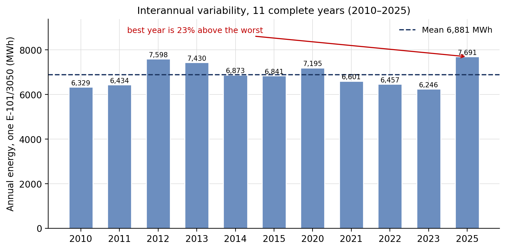

> **Figure 4.13 — Interannual variability of annual energy yield.** One Enercon E-101/3050
> (3.05 MW), density-corrected, ERA5 2010–2025, 11 complete calendar years. Bars are annual
> energy; the dashed line is the 11-year mean. Incomplete years are excluded.

---

## 4.3 Predictability ceiling

The ceiling analysis was conducted before model selection and determined the entire direction
of the study.

### 4.3.1 Autocorrelation ceiling

The target's autocorrelation at a 24-hour lag is **0.571**, which caps R² at **0.326** for any
predictor constructed solely from the atmospheric state at time *t*. The best state-only model
developed in this project reached R² 0.390 on a marginally richer information set — that is,
**already at or above the ceiling**.

### 4.3.2 Learning curve

**Table 4.3 — Test error against training-set length (24 h horizon, state-only features)**

| Training years | Test MAE (m s⁻¹) | Δ | Train/test error ratio |
|---:|---:|---:|---:|
| 0.4 | 1.5017 | — | 2.36 |
| 0.8 | 1.1933 | −0.3085 | 1.52 |
| 1.6 | 1.1534 | −0.0399 | 1.25 |
| 2.4 | 1.1479 | −0.0055 | 1.19 |
| 3.2 | **1.1410** | −0.0069 | **1.16** |

The final doubling of training data bought **1.1%**. The train/test error ratio of 1.16 is the
decisive diagnostic: additional data cures *variance*, and almost none remained to cure.

### 4.3.3 Feature ablation

**Table 4.4 — Cumulative feature-group ablation**

| Feature set | *n* | Test MAE (m s⁻¹) |
|:---|---:|---:|
| Lag / rolling only | 9 | 1.2564 |
| + calendar | 13 | 1.1760 |
| + surface weather | 25 | 1.1615 |
| + upper-air | 33 | 1.1444 |
| + spatial derivatives | 53 | **1.1410** |

The final two groups — 28 columns, including an expensive upper-air download — contributed
**0.02 m s⁻¹ combined**.

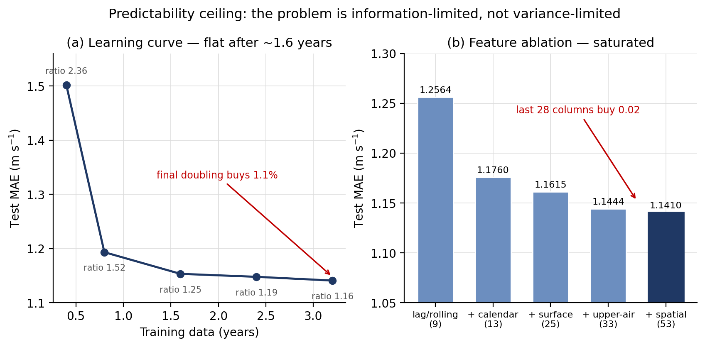

> **Figure 4.1 — The predictability ceiling.** 24 h horizon, ERA5 2020–2023 window,
> state-only features. **(a)** Test MAE against training-set length, annotated with the
> train/test error ratio — a ratio approaching 1 indicates little remaining variance to cure.
> **(b)** Cumulative feature-group ablation. *Reproduced from the measurements recorded in
> `redo/results/05`; regenerating them requires re-running experiments on the retired
> 2020–2023 window.*

### 4.3.4 Interpretation

All three diagnostics agree: the problem was **information-limited, not variance-limited**.
Neither more data nor greater model capacity could have helped materially, because the
information present in the atmospheric state at time *t* was already close to exhausted.

**This is the central methodological result of the study.** It redirected effort from
architecture search — where four prior iterations had been spent — toward acquiring a
different class of information: numerical weather prediction forecasts, which are not subject
to the autocorrelation ceiling because they describe the *target hour* rather than the present
one.

---

## 4.4 Baseline performance

**Table 4.5 — Baselines, 24 h horizon, four rolling-origin folds**

| Baseline | MAE (m s⁻¹) | R² | Parameters |
|:---|---:|---:|---:|
| Naive persistence | 1.3183 | **−0.1078** | 0 |
| Climatology (month × hour) | 1.2725 | 0.0031 | 288 |
| Damped persistence | **1.1861** | **0.1111** | 2 |

**Naive persistence is a weak opponent, and this is now measured rather than asserted.** It
scores R² −0.108 — *worse than predicting the training mean*. Damped persistence uses the same
information with one additional parameter and scores +0.111. Comparing any model against naive
persistence therefore flatters it by approximately 0.13 m s⁻¹.

This has a direct bearing on how the study's headline is stated: **damped persistence is
quoted as the reference throughout**, not naive persistence.

A second baseline finding governs the longer horizons:

**Table 4.6 — Baseline crossover with horizon**

| Horizon | Damped persistence | Climatology | Appropriate reference |
|---:|---:|---:|:---|
| 24 h | **1.1861** | 1.2725 | Persistence-family |
| 48 h | 1.3662 | **1.2844** | **Climatology** |
| 72 h | 1.3439 | **1.3050** | **Climatology** |

Climatology is nearly horizon-independent (+2.6% over 48 hours) because it never used the
recent past; persistence degrades rapidly (+20.4%) as the autocorrelation it depends on decays.
**Beyond approximately 36 hours, climatology is the baseline to beat.** Reporting skill against
persistence at weekly range would inflate the apparent result by roughly 20%.

---

## 4.5 Day-ahead forecasting (24 h)

### 4.5.1 Stage 1 — hub-height wind speed

**Table 4.7 — Day-ahead wind-speed prediction (2024-03 → 2025-12, 15,912 rows, 104 features)**

| Predictor | MAE (m s⁻¹) | R² |
|:---|---:|---:|
| Climatology (training mean) | 1.3490 | −0.0711 |
| Persistence, hub(*t*) → hub(*t*+24) | 1.3097 | −0.0149 |
| OLS on hub(*t*) | 1.1349 | 0.2225 |
| XGBoost **without** NWP (53 features) | 1.0513 | 0.3300 |
| **XGBoost with NWP (104 features)** | **0.7295** | **0.6653** |

**The headline result: adding NWP forecast features reduced MAE by 30.6% and raised R² from
0.3300 to 0.6653.** The full pipeline run with hyperparameter tuning reached 0.738 m s⁻¹ /
R² 0.660 on its own holdout, consistent with the validation-gate figure.

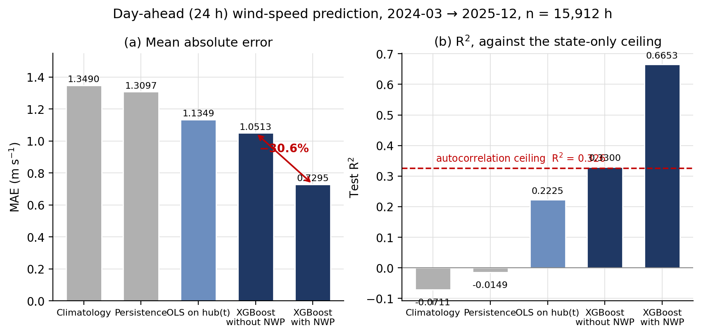

> **Figure 4.2 — Day-ahead prediction against its baselines.** 24 h horizon, ERA5 truth,
> 2024-03 → 2025-12, n = 15,912 h, single chronological split. **(a)** MAE, with the
> NWP-driven reduction marked. **(b)** R² against the state-only autocorrelation ceiling of
> R² = 0.326 — the NWP model passes through it because a forecast of the target hour is not a
> state-at-*t* predictor. *Reproduced from the `validate_nwp` gate run recorded in RESULTS.md.*

Note that the NWP-augmented model passes *through* the 0.326 autocorrelation ceiling of §4.3.1.
This is not a contradiction: the ceiling constrains predictors built on the state at time *t*,
and a forecast of *t* + 24 h is not such a predictor. **The ceiling analysis correctly
identified both the constraint and the only route past it.**

### 4.5.2 Convergence of three estimates of the gain

The magnitude of the improvement was estimated three times on different data, and the
divergence is instructive:

| Estimate | Window | Reported gain |
|:---|:---|---:|
| 12-month ERA5 subset | 2024-03 → 2025-02 | +40.0% |
| NASA POWER, 22 months | 2024-03 → 2025-12 | +23.2% |
| **Full ERA5 window (authoritative)** | **2024-03 → 2025-12** | **+30.6%** |

The +40.0% figure was inflated by baseline overfitting on a short and unusually calm window
(persistence 1.09 m s⁻¹ against 1.3097 on the full window). The +23.2% figure is computed on a
smoother truth source. **The quoted figure is +30.6%**, and the discrepancy is reported rather
than suppressed because it demonstrates the necessity of the re-baselining rule (§3.7).

### 4.5.3 Stage 2 — end-to-end power

**Table 4.8 — Power forecast, 24 h horizon**

| Variant | MAE (W) | R² | nMAE | nRMSE |
|:---|---:|---:|---:|---:|
| Physics only (no ML) | 420,250 | −0.071 | 13.78% | 18.30% |
| **Two-stage** | **228,048** | **0.675** | **7.48%** | **10.08%** |
| Direct | 226,728 | 0.690 | 7.43% | 9.85% |

The two-stage system attains **7.48% nMAE**, against 11.25% for the best state-only
configuration developed earlier in the project.

**Two-stage and direct architectures are within 0.05 percentage points** and swapped order
between truth sources. **The two-stage architecture is therefore not recommended on accuracy
grounds.** Its justification is interpretability and modularity: the wind forecast can be
inspected independently, the turbine can be exchanged without retraining, and failure modes
remain attributable to a specific stage. These are real advantages and they are the ones
claimed.

### 4.5.4 Comparison with published benchmarks

A published two-stage benchmark reports approximately 8.8% nMAE / 13% nRMSE. This study's
7.48% / 10.08% is numerically lower, but the comparison is qualified:

| Criterion | This study | Reference |
|:---|:---|:---|
| Horizon | 24 h | 24 h ✅ |
| Window difficulty (persistence MAE) | 1.31 m s⁻¹ | Comparable ✅ |
| Truth source | **Physics-derived from reanalysis** | **Metered SCADA** ❌ |
| Replication | **Single seed, single split** | — ❌ |

Because two of four criteria fail, the appropriate phrasing is **"comparable to"**, not
**"better than"**. The window-difficulty check is what makes even this claim admissible: an
earlier version of the comparison used a 12-month subset where persistence was 1.09 m s⁻¹, and
the claim would have been inflated.

### 4.5.5 Feature importance

SHAP analysis placed NWP forecast columns in **all of the top six** positions. The single most
important feature was `nwp_icon_global_wind_speed_100m_d1` (0.4780), approximately **six times**
the contribution of the best reanalysis feature (`wind_dir_850hpa_cos`, 0.0804 at rank 7). The
contemporaneous observed wind speed `wind_speed_100m` ranked **13th**.

This ordering is physically sensible — a forecast of the target hour outranks an observation
from 24 hours earlier — and it generated a falsifiable prediction that was tested in §4.9.

An incidental finding: ICON was the single best *raw* forecast on this window (rescaled MAE
0.9743, against ECMWF 1.0410 and GFS 1.0465), **reversing the ordering observed on NASA POWER
truth**. Neither margin is large, and **no claim of NWP model ranking is made.**

---

## 4.6 Classical versus machine-learning methods

This comparison is the study's most consequential result for the interpretation of the
headline, and it was absent from the project's first four iterations.

**Table 4.9 — Eleven predictors, 24 h horizon, `study` features, four rolling-origin folds**

| Rank | Tier | Model | MAE (m s⁻¹) | sd | R² | Skill | Params |
|---:|:---|:---|---:|---:|---:|---:|---:|
| 1 | ML | **XGBoost** | **0.8037** | 0.1023 | 0.5886 | +0.386 | ~10⁵ |
| 2 | ML | LightGBM | 0.8086 | 0.1026 | 0.5831 | +0.383 | ~10⁵ |
| 3 | **Classical** | **Multi-model MOS** | **0.8412** | 0.1193 | 0.5506 | +0.355 | **21** |
| 4 | ML | Ridge | 0.8422 | 0.1129 | 0.5595 | +0.354 | 94 |
| 5 | Classical | Kalman MOS | 0.8572 | 0.1489 | 0.5362 | +0.349 | 4 |
| 6 | Classical | Analogue ensemble | 0.8662 | 0.1509 | 0.5238 | +0.340 | 0 (*k*=25) |
| 7 | Classical | Single-model MOS | 0.9904 | 0.1094 | 0.3883 | +0.239 | **2** |
| 8 | Reference | Damped persistence | 1.1861 | 0.1447 | 0.1111 | +0.094 | 2 |
| 9 | Classical | SARIMAX + exog. NWP | 1.2554 | 0.2675 | 0.0831 | +0.022 | ~10 |
| 10 | Reference | Climatology | 1.2725 | 0.0959 | 0.0031 | +0.021 | 288 |
| 11 | Reference | Naive persistence | 1.3183 | 0.2250 | −0.1078 | 0.000 | 0 |

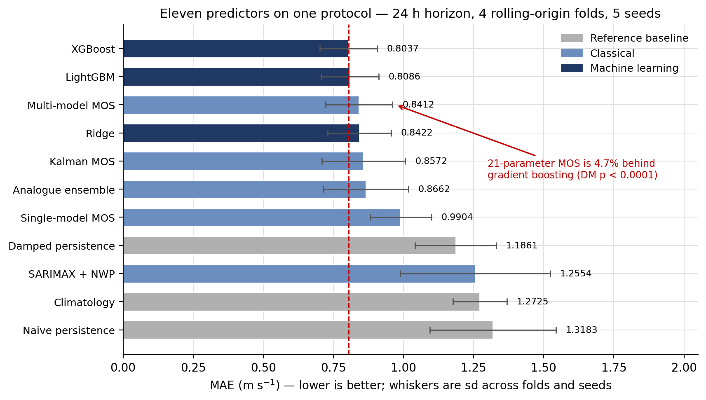

> **Figure 4.3 — Eleven predictors on one protocol.** 24 h horizon, `study` features,
> 2024-03 → 2025-12, four rolling-origin folds, five seeds for stochastic models. Whiskers are
> the standard deviation across folds and seeds; the dashed line marks the best model.
> Reference baseline is naive persistence. Source: `outputs/reports/bakeoff.csv`.

### 4.6.1 The classical–ML gap is 4.7%

Multi-model MOS — ordinary least squares on the day-1 forecast columns plus four calendar
terms, **21 parameters** — lands 0.0375 m s⁻¹ behind a gradient-boosted ensemble with roughly
five orders of magnitude more parameters. Diebold–Mariano confirms the gap is real
(*DM* = −4.816, *p* < 0.0001) but small.

### 4.6.2 Where the skill actually enters

**Table 4.10 — Decomposition of the improvement by rung**

| Step | MAE | Gained | Nature |
|:---|---:|---:|:---|
| Persistence → damped persistence | 1.3183 → 1.1861 | 0.13 | Shrinkage toward the mean |
| Damped persistence → single-model MOS | 1.1861 → 0.9904 | **0.20** | **Having a forecast at all** (2 params) |
| Single- → multi-model MOS | 0.9904 → 0.8412 | **0.15** | Combining three NWP models + calendar |
| Multi-model MOS → gradient boosting | 0.8412 → 0.8037 | 0.04 | **Everything machine learning adds** |

**The two largest steps are both classical, and neither involves learning anything beyond a
linear fit.**

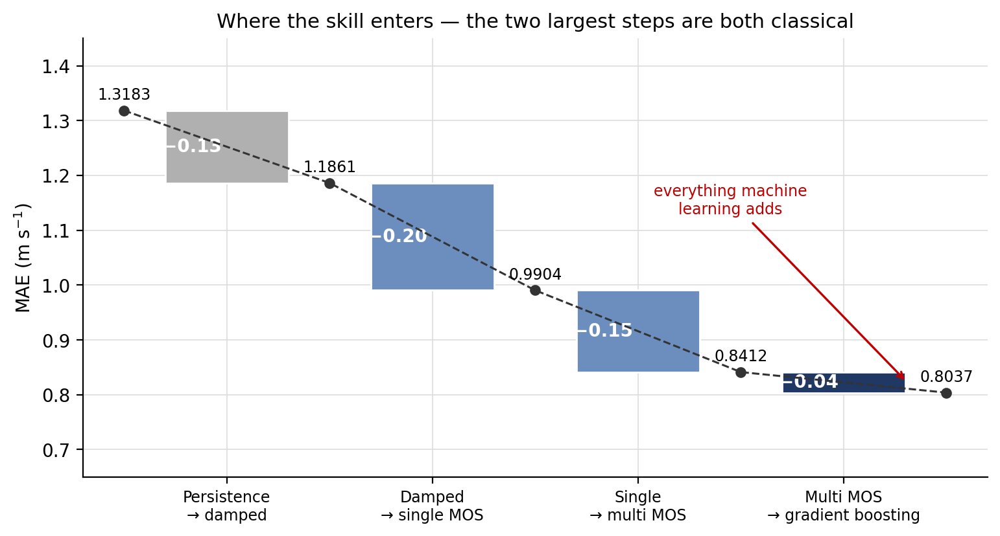

> **Figure 4.4 — Where the forecast skill enters.** 24 h horizon, `study` features, four
> rolling-origin folds. Each bar is the MAE reduction bought by one rung of the ladder; the
> dashed line traces the cumulative error. Bar shading follows the tier encoding of Figure 4.3.
> Source: `outputs/reports/bakeoff.csv`.

### 4.6.3 Interpretation: an information effect, not a machine-learning effect

The v5 headline — a ~30% MAE reduction from adding NWP features — is intact, but its
attribution changes materially:

> **The gain is overwhelmingly an information effect, not a machine-learning effect.** Most of
> it is available to a 21-parameter linear model. Gradient boosting contributes a real but
> small additional 4.7%.

This is the **stronger** framing, not the weaker one. It answers the obvious examination
question — *"was machine learning necessary at all?"* — with a precise answer: for the final
4.7%, yes, and here is the significance test. A study that had compared only against
persistence could not have made this statement, and would have implicitly attributed the entire
30% to the machine-learning method.

### 4.6.4 SARIMAX and the ceiling made visible

SARIMAX with exogenous NWP regressors scores 1.2554 m s⁻¹, a skill of only **+0.022** over
persistence. This is the autocorrelation ceiling appearing directly in a model's score: the
autoregressive terms decay within a few steps of a multi-thousand-step-ahead forecast, leaving
essentially a poorly-specified MOS. **Reporting an ARIMA-family model that barely beats
persistence is evidence for the ceiling argument, not an embarrassment.**

### 4.6.5 Why rolling-origin validation was necessary

**Table 4.11 — Per-fold detail (seed 42)**

| Fold | Test period | Persistence | Damped | MOS-multi | XGBoost |
|:---|:---|---:|---:|---:|---:|
| 1 | 2024-12-24 → 2025-03-27 | 1.1129 | 1.0345 | 0.8743 | 0.7793 |
| 2 | 2025-03-27 → 2025-06-28 | **1.6274** | 1.3827 | 0.9866 | 0.9603 |
| 3 | 2025-06-28 → 2025-09-29 | 1.2001 | 1.1725 | **0.7043** | **0.7031** |
| 4 | 2025-09-29 → 2025-12-30 | 1.3330 | 1.1546 | 0.7997 | 0.7656 |

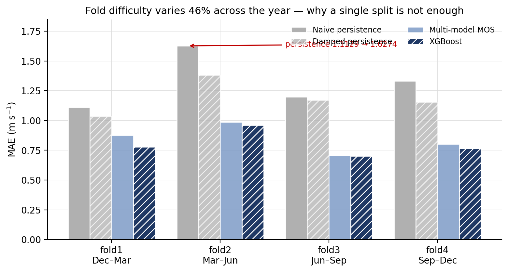

> **Figure 4.5 — Problem difficulty varies 46% across the year.** 24 h horizon, `study`
> features, seed 42, four rolling-origin folds covering 2024-12 → 2025-12. Each fold's test
> block is a different quarter. Source: `outputs/reports/bakeoff_folds.csv`.

Two observations are visible only fold by fold:

1. **Problem difficulty swings 46%** across the year (persistence 1.1129 → 1.6274). A single
   split places the evaluation somewhere in that range essentially at random, so a
   single-split MAE is partly a statement about which quarter was tested.
2. **In fold 3, MOS-multi and XGBoost differ by 0.0012 m s⁻¹** — a dead heat. The
   machine-learning advantage is not uniform through the year; it concentrates in the harder
   quarters.

---

## 4.7 Architecture comparison: deep learning

**Table 4.12 — Five architectures, 24 h horizon, single split, three seeds, `study` features**

| Model | Mean MAE | Seed sd | Range | R² | Min/fit | Relative cost |
|:---|---:|---:|---:|---:|---:|---:|
| **XGBoost** | **0.7329** | **0.0035** | 0.0068 | 0.6615 | 0.1 | 1× |
| LSTM | 0.7701 | 0.0276 | 0.0505 | 0.6217 | 4.8 | ~42× |
| N-BEATS | 0.8234 | 0.0361 | 0.0705 | 0.5646 | 20.7 | ~185× |
| DLinear | 0.8244 | 0.0115 | 0.0215 | 0.5837 | 1.1 | ~10× |
| **TFT** | **0.8826** | **0.0614** | **0.1090** | 0.5188 | **231.1** | **~2,000×** |

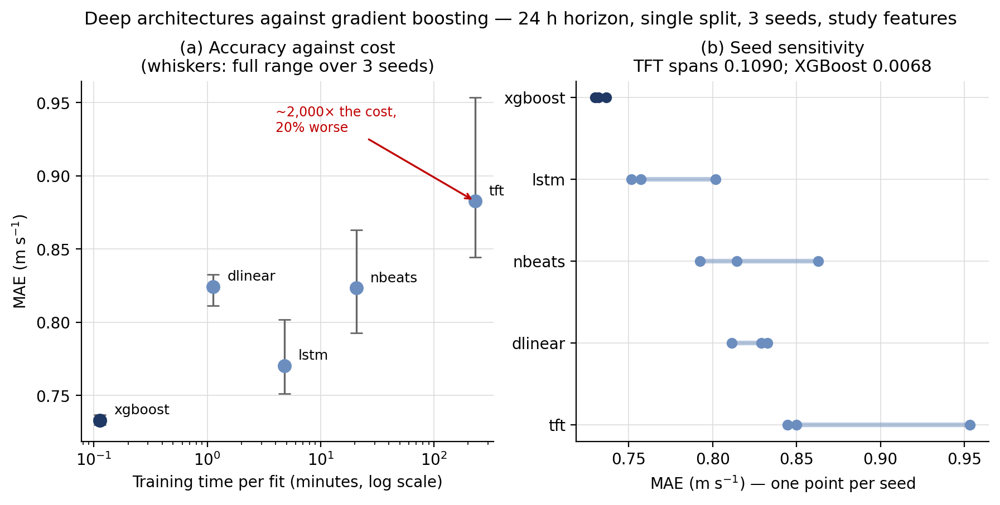

> **Figure 4.6 — Deep architectures against gradient boosting.** 24 h horizon, `study`
> features, 2024-03 → 2025-12, single chronological split, three seeds (42, 7, 1234).
> **(a)** Mean MAE against training time per fit, log-scaled; whiskers span the full seed
> range. **(b)** Individual seed results, showing that deep architectures overlap where the
> tree does not. Source: `outputs/reports/bakeoff_deep.csv`.

### 4.7.1 Trees outperform deep architectures on this problem

The gradient-boosted tree leads the best deep model by **5.1%** at roughly **1/42** of the
training cost. The Temporal Fusion Transformer — the architecture with the strongest
theoretical prior for this task, since it handles known-future covariates natively, which is
exactly what an NWP forecast is — finished **last**, at approximately 2,000× the cost of
XGBoost for a 20% worse result.

### 4.7.2 Seed sensitivity is not uniform across model classes

**Deep architectures are 3–18× more seed-sensitive than the tree.** LSTM's range across three
seeds (0.0505) *exceeds its entire mean gap to XGBoost* (0.0372). TFT is the extreme case:
seeds 42 and 7 agree to within 0.0056 (0.8444, 0.8500) while seed 1234 falls 0.1090 away at
0.9535.

**No single-seed experiment could detect this**, and every architecture conclusion in the
project's first four iterations was single-seed. A single-seed TFT run could have reported any
value between 0.844 and 0.954 — a span wider than the entire distance between the best and
worst model in Table 4.12.

N-BEATS and DLinear differ by 0.0010 m s⁻¹ on the mean and overlap heavily across seeds. **On
this evidence they are tied**, and any ordering between them would be noise.

### 4.7.3 A cross-source finding that did not transfer

The same comparison run against NASA POWER truth gave XGBoost 0.678 and TFT 0.827 — an **18%**
gap with TFT as the best deep model. On ERA5 truth the gap is **5.1%** and TFT is **last**.

| Truth source | XGBoost | Best deep model | Gap |
|:---|---:|:---|---:|
| NASA POWER, 22 mo | 0.678 | 0.827 (**TFT**) | **18%** |
| **ERA5, 22 mo** | **0.7329** | **0.7701 (LSTM)** | **5.1%** |

**The direction holds; the magnitude and the runner-up identity do not.** The earlier run —
single-seed — selected as its winner the architecture with the widest seed variance in the
entire study. This is a coherent and cautionary story about single-seed model selection.

Three artefact explanations for the direction were tested and all failed: identical splits
(3,183 test points on both paths), identical alignment (persistence 1.1100 on both), and
insensitivity to hyperparameter tuning. A plausible mechanism — that a forecast column whose
value at *t* is close to the answer at *t* + 24 h is precisely the structure a decision tree
splits on directly, whereas sequence models must propagate it through an encoded input window
— **is offered as a hypothesis and explicitly not as a finding**, since it was not tested.

---

## 4.8 Skill decay with horizon (24 h → 72 h)

**Table 4.13 — Operational features, four rolling folds, MAE in m s⁻¹**

| Model | 24 h | 48 h | 72 h | 24→72 change |
|:---|---:|---:|---:|---:|
| XGBoost | **0.8009** | **0.8739** | **0.9280** | +15.9% |
| LightGBM | 0.8032 | 0.8824 | 0.9431 | +17.4% |
| Ridge | 0.8383 | 0.9093 | 0.9645 | +15.0% |
| Multi-model MOS | 0.8412 | 0.9202 | 0.9658 | +14.8% |
| Climatology | 1.2725 | 1.2844 | 1.3050 | **+2.6%** |
| Damped persistence | 1.1861 | 1.3662 | 1.3439 | +13.3% |
| Naive persistence | 1.3183 | 1.6162 | 1.5873 | +20.4% |

### 4.8.1 Decay decelerates

Skill against climatology — the correct long-lead reference — falls **0.371 → 0.320 → 0.289**
at 24 / 48 / 72 h. The loss per additional day is *shrinking* (−0.051, then −0.031). This
deceleration is what made a weekly product worth attempting; had skill converged on climatology
by 72 h, the correct decision would have been to stop.

### 4.8.2 The classical–ML gap does not erode with lead time

| Horizon | MOS-multi | XGBoost | Gap |
|---:|---:|---:|---:|
| 24 h | 0.8412 | 0.8009 | 5.0% |
| 48 h | 0.9202 | 0.8739 | 5.3% |
| 72 h | 0.9658 | 0.9280 | 4.1% |

The §4.6.3 finding is therefore not a short-horizon artefact.

### 4.8.3 A skill score is only as good as its denominator

XGBoost's skill **against persistence** rises across the three horizons (+0.388 → +0.457 →
+0.414), which superficially suggests the model improves with lead time. It does not:
persistence is collapsing faster than the model is. This is precisely why the
climatology-referenced figures of §4.8.1 are the ones quoted.

---

## 4.9 Deployment rehearsal: operational versus study features

This measurement addresses the study's central deployability question. Of 104 features, 53 are
ERA5-derived and therefore unavailable at issue time.

**Table 4.14 — Study versus operational feature sets, 24 h horizon, four rolling folds**

| Model | `study` (94 feats) | `operational` (55 feats) | Difference |
|:---|---:|---:|---:|
| **XGBoost** | 0.8037 | **0.8009** | **−0.0028** |
| LightGBM | 0.8086 | **0.8032** | −0.0054 |
| Ridge | 0.8422 | **0.8383** | −0.0039 |
| Classical models (all) | unchanged | unchanged | 0.0000 |

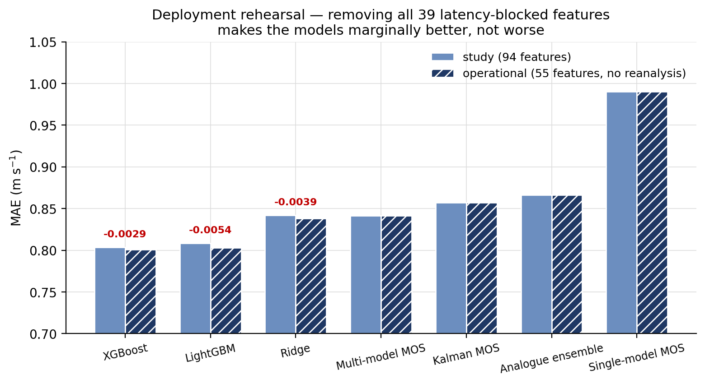

> **Figure 4.7 — Deployment rehearsal.** 24 h horizon, four rolling-origin folds,
> 2024-03 → 2025-12. `study` uses all 94 live features; `operational` uses only the 55 that
> exist at issue time. Annotations give the signed change; negative means the operational
> model is *better*. Classical models are unchanged by construction, since they read only NWP
> and calendar columns. Source: `outputs/reports/bakeoff.csv`.

### 4.9.1 The degradation is negative

> **Removing every latency-blocked reanalysis feature costs nothing. All three models that can
> see reanalysis perform marginally *better* without it.**

The deployability concern is therefore **real in principle and free in practice at this site**.
Before this measurement the honest position was "the headline is an offline number and the
operational score is unknown". After it: **the operational score is known, and it is the same.**

### 4.9.2 Mechanism and pre-registration

The mechanism is consistent with the SHAP ranking of §4.5.5: **a day-ahead forecast of the
target hour is simply better information than an observation from 24 hours earlier.** Once the
forecast is present the analysed state at *t* is largely redundant, and 39 redundant,
partly-collinear columns constitute a small liability rather than an asset.

A prediction to this effect was recorded **before** the measurement, together with its hedge —
*"SHAP importance is not the same as ablation loss, so this is a hypothesis"* — and is retained
verbatim. The prediction was correct. A pre-registration rewritten once the answer is known is
worth nothing; this one was not rewritten.

### 4.9.3 What this does not establish

- It does **not** make the system deployable. There is no wind farm at Anloga, no SCADA, no
  serving path, no monitoring and no retraining schedule. One blocker is removed, not all.
- It does **not** verify lead-time semantics. `previous_day1` is a fixed *day* offset, so the
  effective lead varies through the target day (~24–47 h) and has not been checked hour by hour.
- It is **one site and one horizon.** At a location with weaker NWP skill, or at a shorter
  horizon where persistence is strong, reanalysis features could matter considerably more.
- Deep models were **not** run on the operational feature set.

> ✅ **The "one site" caveat has since been tested — see §4.15.** The 24 h ladder was run
> unchanged at Ghana's 16 regional capitals plus Anloga. The prediction in the third bullet
> above gets a **split verdict**: dropping reanalysis features is costlier away from Anloga at
> **15 of 17** sites and the cost concentrates in the northern savannah exactly as predicted
> (sign test p ≈ 0.0003), but **no single site's penalty exceeds its own seed standard
> deviation**, so the magnitude is not established at any individual site. The bullet is left
> as written; §4.15 carries the measurement. **The horizon half remains untested** — §4.15 is
> 24 h only.

---

## 4.10 Multi-day forecasting (24 h to 168 h)

Seven models, one per forecast lead day, in valid-time framing.

**Table 4.15 — Per-lead performance, hub wind speed, MAE in m s⁻¹**

| Lead | Horizon | Members | Climatology | Raw ens. mean | MOS-single | MOS-multi | **XGBoost** | Skill |
|---:|---:|---:|---:|---:|---:|---:|---:|---:|
| d1 | 24 h | 3 | 1.2065 | 1.0645 | 0.8890 | 0.7733 | **0.7322** | **0.393** |
| d2 | 48 h | 3 | 1.2075 | 1.0579 | 0.9236 | 0.8606 | **0.8251** | 0.317 |
| d3 | 72 h | 3 | 1.2087 | 1.0461 | 0.9251 | 0.9098 | **0.8729** | 0.278 |
| d4 | 96 h | 3 | 1.2085 | 1.0427 | 0.9334 | 0.9355 | **0.9166** | 0.242 |
| d5 | 120 h | 3 | 1.2088 | 1.0583 | 0.9321 | 0.9289 | **0.9147** | 0.243 |
| d6 | 144 h | 3 | 1.2085 | 1.0708 | 0.9844 | 0.9609 | **0.9354** | 0.226 |
| **d7** | **168 h** | **2** | 1.2075 | 1.0418 | 1.0578 | 0.9802 | **0.9580** | **0.207** |

**A seven-day forecast beats climatology by 20.7%.** The model does not collapse at weekly
range.

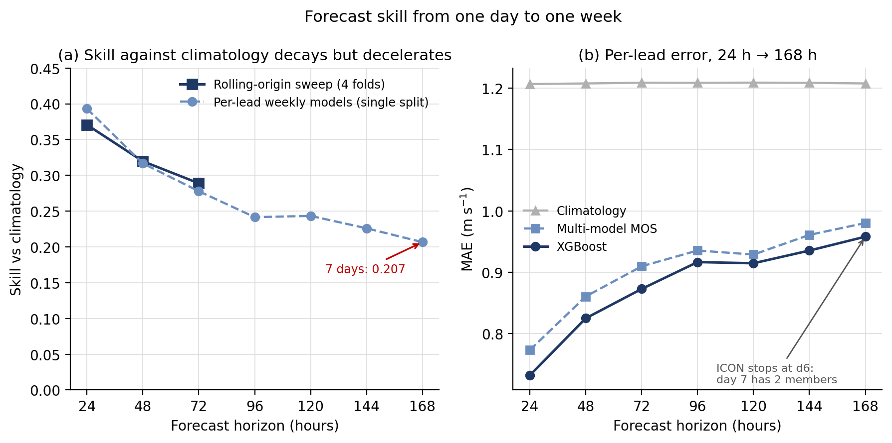

> **Figure 4.8 — Forecast skill from one day to one week.** **(a)** Skill against climatology.
> Squares are the rolling-origin sweep (four folds, `operational` features, 24/48/72 h);
> circles are the per-lead weekly models (single split, seed 42, 24–168 h). The two protocols
> agree closely where they overlap. **(b)** Per-lead MAE for climatology, multi-model MOS and
> XGBoost. ⚠️ The climatology reference here is a *training-window* climatology — see §4.12.4.
> Sources: `bakeoff.csv`, `bakeoff_h48.csv`, `bakeoff_h72.csv`, `weekly_leads.csv`.

### 4.10.1 The extrapolation was optimistic, and by a measurable amount

§4.8.1's geometric extrapolation projected ~0.25 skill at 168 h; the measurement is **0.207**.

| | 96 h | 120 h | 144 h | 168 h |
|:---|---:|---:|---:|---:|
| Projected | ~0.27 | ~0.26 | ~0.25 | ~0.25 |
| **Measured** | **0.242** | **0.243** | **0.226** | **0.207** |

Decay is **slightly faster than geometric**. The projection was labelled an extrapolation from
three points rather than a result, and that caution proved warranted: the direction was correct,
the magnitude drifted ~17% by day 7.

### 4.10.2 Energy aggregation

Hourly errors partially cancel when summed over a week:

| Lead | Hourly nMAE | Weekly-energy nMAE (of rated) |
|---:|---:|---:|
| d1 (24 h) | 7.73% | **2.24%** |
| d7 (168 h) | 10.32% | **3.95%** |

**Weekly energy is predictable to ~4% of rated capacity at seven days' lead** — approximately
2.6× cancellation relative to the hourly error. For resource and scheduling purposes this is
the more decision-relevant figure.

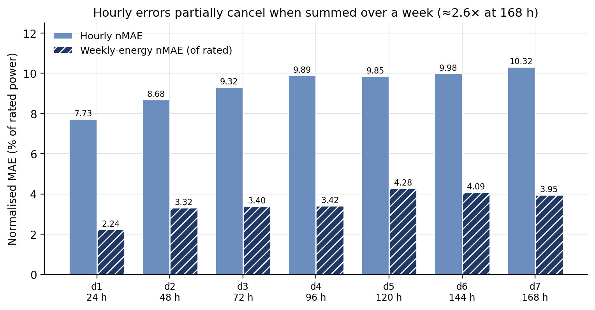

> **Figure 4.9 — Hourly errors partially cancel when summed over a week.** Per-lead
> normalised MAE as a percentage of rated power (3.05 MW), single chronological split, seed 42,
> 18–19 non-overlapping weeks in the test fold. Source: `outputs/reports/weekly_leads.csv`.

### 4.10.3 The ensemble-membership trade

ICON's lead ceiling forces a choice between a 168 h forecast on two ensemble members and a
144 h forecast on three. A documented prior held that losing a member would hurt more than
gaining a day. **The prior was refuted:**

| Configuration | XGBoost MAE | Coverage |
|:---|---:|---:|
| d6, three members | 0.9354 | 0.705 |
| d6, two members (ICON removed) | **0.9343** | 0.719 |

Dropping ICON costs nothing measurable. **The 168 h product is therefore taken.**

### 4.10.4 Probabilistic forecasting: calibration fails

| Nominal coverage | Observed coverage (P10–P90) |
|---:|---:|
| 0.80 | **0.651 – 0.743** |

**The quantile intervals are not calibrated** — they are systematically too narrow at every
lead. This is reported as a failure rather than corrected by widening, because an interval
tuned until it achieves nominal coverage on the test set has been *fitted to the test set*, not
calibrated.

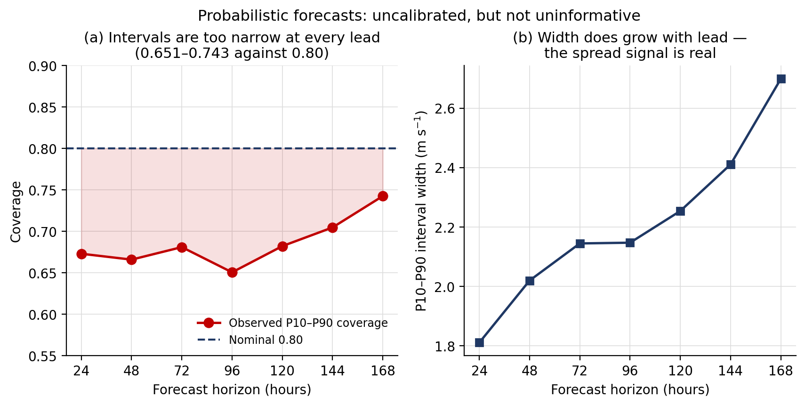

> **Figure 4.10 — Probabilistic forecasts are uncalibrated but not uninformative.**
> P10–P90 intervals, single chronological split, seed 42, ~3,180 test hours per lead.
> **(a)** Observed coverage against the 0.80 nominal target; the shaded gap is the
> under-dispersion. **(b)** Interval width grows monotonically with lead, confirming the
> inter-model spread feature responds to genuine uncertainty. Source: `weekly_leads.csv`.

What does work: interval width grows monotonically with lead (1.81 → 2.70 m s⁻¹) and coverage
improves with it, confirming that the inter-model spread feature tracks genuine uncertainty.
The model is simply under-dispersed. The remedy — recalibration on a held-out validation fold,
or a conformal wrapper guaranteeing coverage by construction — is identified as future work.

---

## 4.11 Monthly resource assessment

### 4.11.1 Ceiling analysis at monthly scale

The ceiling procedure was repeated at monthly scale **before** any monthly model was attempted.

**Table 4.16 — Monthly-scale predictability (156 months)**

| Quantity | Value | Implication |
|:---|---:|:---|
| Seasonal cycle share of monthly-CF variance | **81.6%** | The calendar is the model |
| Interannual anomaly share | 18.4% | All that a model can compete for |
| Anomaly standard deviation | 0.0454 CF | |
| Lag-1 anomaly autocorrelation | **0.229** | R² ceiling 0.052 |
| Lag-2 / lag-3 | 0.101 / 0.040 | Signal gone by month 2 |

**Four-fifths of month-to-month variation at Anloga is simply which month it is.**

**Table 4.17 — Monthly baselines**

| Baseline | MAE (CF) | pp of rated |
|:---|---:|---:|
| **Climatology (leave-one-year-out)** | **0.0402** | **4.02** |
| Climatology (in-sample) | 0.0371 | 3.71 |
| Anomaly persistence | 0.0447 | 4.47 |

Two findings invert habits carried from the 24 h regime:

1. **Persistence is worse than climatology at monthly scale** (0.0447 vs 0.0402). At 24 h
   damped persistence beats climatology; by 48 h it loses; at monthly scale it is beaten
   outright. Last month's anomaly is not evidence about this month's.
2. **In-sample climatology flatters by 7.6%.** Estimating the month-of-year mean from a set
   including the target month gives 0.0371 rather than 0.0402. Any model scored against the
   in-sample figure inherits that flattery.

### 4.11.2 The monthly resource product

**Table 4.18 — Exceedance capacity factor by calendar month (fitted-normal estimator)**

| Month | Years | Mean CF | **P50** | **P75** | **P90** | P50 energy (MWh) |
|:---|---:|---:|---:|---:|---:|---:|
| Jan | 13 | 0.1883 | 0.1883 | 0.1564 | 0.1277 | 427 |
| Feb | 13 | 0.2868 | 0.2868 | 0.2497 | 0.2163 | 588 |
| Mar | 14 | 0.3351 | 0.3351 | 0.3025 | 0.2731 | 760 |
| Apr | 14 | 0.2483 | 0.2483 | 0.2197 | 0.1939 | 545 |
| May | 14 | 0.1782 | 0.1782 | 0.1493 | 0.1233 | 404 |
| Jun | 14 | 0.2437 | 0.2437 | 0.2023 | 0.1649 | 535 |
| Jul | 14 | 0.4114 | 0.4114 | 0.3750 | 0.3422 | 934 |
| **Aug** | 12 | **0.4292** | **0.4292** | 0.3979 | 0.3698 | **974** |
| Sep | 12 | 0.3365 | 0.3365 | 0.3057 | 0.2780 | 739 |
| Oct | 12 | 0.1742 | 0.1742 | 0.1493 | 0.1268 | 395 |
| Nov | 12 | 0.1408 | 0.1408 | 0.1231 | 0.1072 | 309 |
| **Dec** | 12 | **0.1400** | **0.1400** | 0.1096 | 0.0823 | 318 |

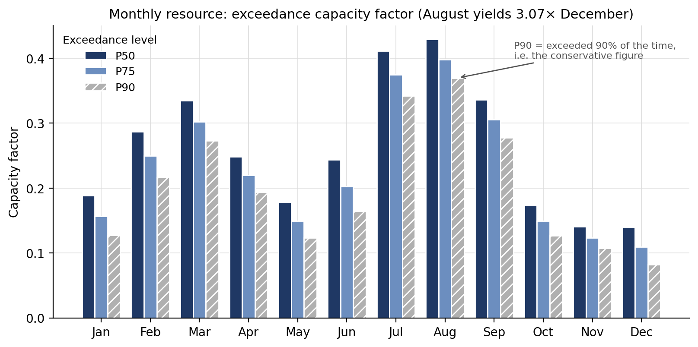

> **Figure 4.11 — Monthly resource: exceedance capacity factor.** ERA5 2010-01 → 2026-07,
> 156 complete months, 12–14 years per calendar month, fitted-normal estimator (§4.11.3),
> density-corrected E-101/3050. **P*XX* is the value exceeded *XX*% of the time**, so P90 is
> the conservative figure. Source: `outputs/reports/monthly_climatology.csv`.

**August yields 3.07× December.** The South-West monsoon maximum (Jul–Sep) and the Harmattan
minimum (Oct–Dec) dominate the annual cycle. Interannual standard deviation is roughly uniform
across months (0.026–0.062), so **no month is meaningfully more predictable than another —
only windier.**

### 4.11.3 Estimator selection: the empirical P90 fails in the dangerous direction

**Table 4.19 — Leave-one-year-out exceedance calibration (n = 156)**

| Level | Nominal | Empirical estimator | **Fitted normal** |
|:---|---:|---:|---:|
| P50 | 0.50 | 0.4936 | 0.4808 |
| P75 | 0.75 | 0.7115 | 0.7179 |
| **P90** | **0.90** | **0.8462** ❌ | **0.8974** ✅ |

The natural estimator — the empirical 10th percentile — is exceeded only **84.6%** of the time
against a nominal 90%, meaning **the published P90 would have been too high, i.e. too
optimistic**. For a figure used to size a power purchase agreement or a debt service cover
ratio, optimistic is the dangerous direction.

The cause is sample size rather than concept: with 12–14 years per calendar month, the
empirical 10th percentile lies between the first and second order statistics and shifts by an
entire rank when one year is withheld. A fitted-normal tail uses all observations to locate the
tail and lands within **0.3 percentage points** of nominal.

Note the trade-off: the fitted normal is slightly *worse* at P50 (0.4808 vs 0.4936). It is
selected because the tail is what an exceedance product exists to state.

### 4.11.4 Diurnal structure and its implications for hybrid generation

| Quantity | Range in mean CF |
|:---|---:|
| Seasonal (Aug − Dec monthly means) | 0.289 |
| Diurnal (February, best − worst hour) | **0.207** |
| Diurnal (November, best − worst hour) | 0.107 |

Wind peaks at **16:00–21:00 UTC** and troughs at **08:00–11:00 UTC** in every month of the
year; because Ghana observes UTC+0 these are local hours.

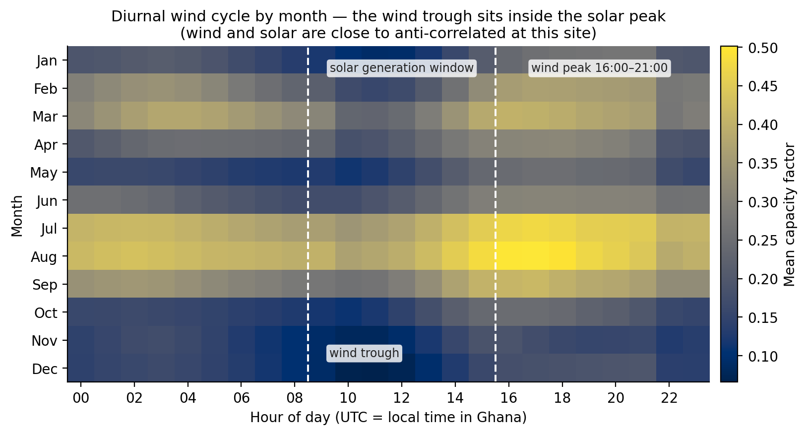

> **Figure 4.12 — Diurnal wind cycle by calendar month.** Mean capacity factor, ERA5
> 2010-01 → 2026-07, 156 months, density-corrected E-101/3050. Hours are UTC, which is also
> local time in Ghana. Dashed lines bound the approximate solar generation window: **the wind
> trough sits inside the solar peak, and the wind peak sits where solar output is falling
> away.** Source: `outputs/reports/monthly_diurnal.csv`.

**This is the most operationally useful finding in the resource analysis.** The wind minimum
coincides with the solar maximum, and the wind maximum with the solar decline — the two
resources are close to **anti-correlated on the diurnal cycle** at this site. A wind–solar
hybrid would therefore exhibit materially smoother combined output than either technology
alone. The diurnal swing rivals the seasonal one in magnitude, and it emerges from the
climatology rather than from any forecast.

---

## 4.12 Thirty-day outlook

### 4.12.1 The first test was structurally underpowered

The initial outlook evaluation, scored on calendar-month totals, returned **+4.4% skill with a
95% confidence interval of [−10.5%, +19.1%]** — no demonstrable skill. Diagnosis revealed the
design, not merely the sample size, to be at fault.

A 7-day forecast constitutes **23% of a 30-day month**. The remaining 77% is climatological
tail error that is *identical in both arms* and, under an absolute-error metric, does not
cancel — it only inflates the variance against which the comparison is measured.

| Component | MAE (CF) | Share |
|:---|---:|---:|
| Climatology baseline | 0.0346 | 100% |
| **Perfect-head floor** (23-day climatological tail) | **0.0262** | **76%** |
| Maximum movable by the forecast | 0.0084 | 24% |

> **The design's minimum detectable effect was 26.1%, against a ceiling of 13.1%. It could not
> have resolved even a perfect forecast.** The null result was guaranteed by the experimental
> design rather than by the physics.

### 4.12.2 The ceiling on any monthly outlook

**Table 4.20 — Skill attainable with perfect knowledge of the first *N* days**

| Perfect days | Monthly MAE (pp of rated) | Skill vs LOYO climatology |
|---:|---:|---:|
| 0 | 4.02 | 0.0% |
| 3 | 3.66 | 9.0% |
| 5 | 3.63 | 9.7% |
| **7** | **3.49** | **13.1%** |
| 14 | 2.78 | 30.7% |
| 21 | 1.95 | 51.5% |
| 30 | 0.22 | 94.5% |

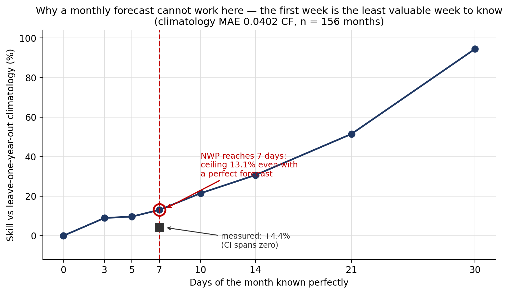

> **Figure 4.14 — Why a monthly forecast is not achievable at this site.** Skill against
> leave-one-year-out climatology as a function of how many days of the month are known
> *perfectly*. ERA5 2010-01 → 2026-07, 156 months, climatology MAE 0.0402 CF. The vertical line
> marks the limit of NWP availability (lead day 7); the square is the measured outcome.
> *Curve reproduced from `redo/results/10`; computing it requires the hourly series, which the
> monthly CSV does not carry.*

Note the shape: knowing the first seven days perfectly buys 13.1 points; the *second* week buys
a further 17.6. **The first week is the least valuable week to know**, because a monthly total
is dominated by the three weeks a forecast cannot reach.

### 4.12.3 The re-powered evaluation

The forecast was re-scored on **non-overlapping 7-day blocks**, where it constitutes 100% of
the prediction rather than 23%. Sample rose from 22 to 114; the minimum detectable effect was
**pre-registered at 8.2%** before any result was examined.

**Table 4.21 — Model ladder, 7-day energy blocks, capacity factor, archive climatology reference**

| Arm | Block MAE (CF) | Skill | DM *p* |
|:---|---:|---:|---:|
| Archive climatology *(reference)* | 0.0728 | — | — |
| Training-window climatology | 0.1110 | **−52.5%** | 1.4 × 10⁻⁵ |
| Raw ensemble mean | 0.0918 | **−26.1%** | 1.9 × 10⁻³ |
| Single-model MOS | 0.0637 | +12.5% | 0.110 *(ns)* |
| Multi-model MOS | 0.0505 | +30.7% | 2.8 × 10⁻⁴ |
| **XGBoost** | **0.0441** | **+39.4%** | **1.1 × 10⁻⁵** |

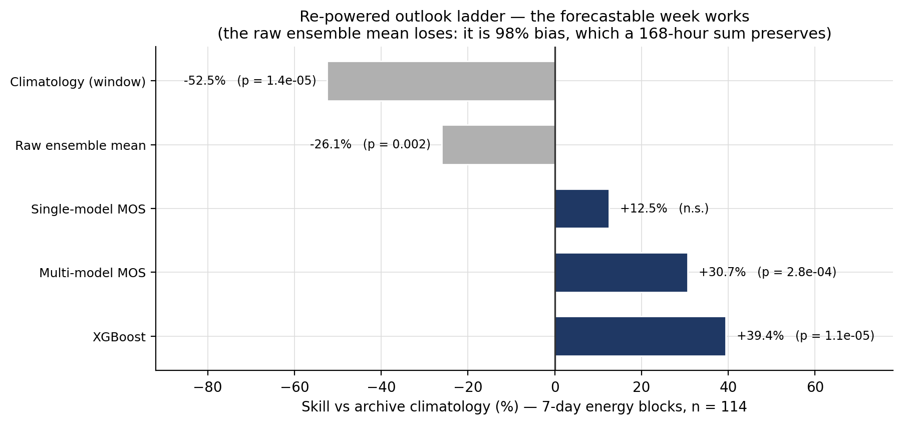

> **Figure 4.15 — The re-powered outlook ladder.** Skill against archive climatology on
> non-overlapping 7-day energy blocks, capacity-factor units, walk-forward with monthly refit,
> n = 114 blocks over 2024-05 → 2026-07. Diebold–Mariano *p*-values use HAC lag 1. Grey bars
> lose to the reference. Source: `outputs/reports/outlook_block_summary.csv`.

The same forecasts and the same models moved from *p* ≈ 0.5 to *p* = 1.1 × 10⁻⁵. **Only the
scale at which they were scored changed.** Single-model MOS returns a non-significant +12.5%,
demonstrating that the re-powered test distinguishes "small" from "absent" rather than
declaring everything absent.

### 4.12.4 The reference baseline outweighed every modelling decision

Scored against the training-window climatology, XGBoost returns **+60.3%**; against the
admissible 14-year archive climatology, **+39.4%**. **A 21-point swing produced entirely by the
choice of reference** — larger than the gap between the best and worst candidate in Table 4.21.

The archive climatology is the admissible reference because it is *operationally available*:
ERA5's five-day publication latency is irrelevant to a climatological mean.

> **This has consequences for §4.10.** The skill column in Table 4.15 is computed against a
> training-window climatology and is therefore measured against a weak reference. Those figures
> are correct for what they measure but are **not comparable** to the archive-referenced figures
> here, and their like-for-like values would be lower. This is flagged rather than silently
> restated.

### 4.12.5 The best model depends on the objective

| Objective | Winner |
|:---|:---|
| Hourly wind speed (m s⁻¹) | **XGBoost** — 7 of 7 leads |
| Hourly capacity factor | **Multi-model MOS** — 5 of 7 leads |
| 7-day energy blocks (CF) | **XGBoost** — 12.6% ahead |

Because the power curve is strongly nonlinear, the model that minimises wind-speed error is not
necessarily the model that minimises energy error. **The project selected models on m s⁻¹ while
the deliverable is energy.** Neither result is wrong — they optimise different objectives — but
any claim of the form "XGBoost is the best model here" must state *best at what*.

XGBoost wins on aggregates because it carries both lower bias (−0.0215 vs −0.0225 CF) and lower
block-error scatter (sd 0.0595 vs 0.0629), even while losing most hourly leads.

### 4.12.6 The raw ensemble mean is almost entirely bias

| Arm | Block bias (CF) | Block MAE | \|bias\|/MAE |
|:---|---:|---:|---:|
| **Raw ensemble mean** | **−0.0902** | 0.0918 | **98%** |
| Single-model MOS | −0.0428 | 0.0637 | 67% |
| Archive climatology | −0.0301 | 0.0728 | 41% |
| Multi-model MOS | −0.0225 | 0.0505 | 45% |
| XGBoost | −0.0215 | 0.0441 | 49% |

The raw multi-model mean beats climatology at every lead on *hourly* error yet loses by 26.1%
on *weekly* aggregates. The reason is that it is **98% bias**: hourly MAE partly forgives a
systematic offset because scatter dominates the metric, whereas a 168-hour sum preserves bias
exactly. **This is the quantitative case for MOS post-processing** — the correction is not
buying sharpness, it is removing a systematic offset that an energy product would otherwise
carry directly to the bottom line.

### 4.12.7 The monthly product: improved, and still not significant

| | *n* | MAE (CF) | Skill | 95% CI | Width |
|:---|---:|---:|---:|:---|---:|
| Original design | 22 | 0.0342 | +1.1% | [−19.7%, +17.7%] | 37.4 pp |
| **Re-powered, XGBoost head** | **26** | **0.0378** | **+4.4%** | **[−10.5%, +19.1%]** | **29.5 pp** |

The interval narrowed by 21% and the point estimate rose, but it **still spans zero** — exactly
as pre-registered. The 13.1% ceiling never moved and could not: the forecast still covers ~23%
of a month.

> **A 39.4% improvement on the part that is forecastable becomes a ~4% improvement on a monthly
> total, because three-quarters of a month is not forecastable at all. The re-powering did not
> rescue the monthly outlook; it explained it.**

The binding constraint is sample size, not model quality. The NWP archive begins 2024-03 and
grows one month per month; resolving a true 5% effect would require on the order of 100+ months.

---

## 4.13 Defects surfaced by the verification protocol

Eight defects were surfaced by the guards of §3.5 during development. **None caused a crash**,
and several produced numbers that *agreed with a reasonable prior* — which is precisely why
explicit falsifiable checks outperform careful reading.

**Table 4.22 — Defects, detection mechanism, and consequence if unreported**

| # | Defect | Caught by | Consequence avoided |
|---:|:---|:---|:---|
| 1 | SARIMAX numerically explosive (MAE 4.4619, R² −7.82) | Sanity floor | Would have been written up as "ARIMA performs poorly" — directionally true, hence easy to accept |
| 2 | Significance test comparing different time periods | Length assertion | Stochastic models judged on fold 1 only, in a window where difficulty varies 46% |
| 3 | "24-hour persistence" was 25-hour persistence | Exact-lag test | A 2.9%-inflated baseline beneath every historical claim |
| 4 | Ten mathematically dead spatial features | Zero-variance check | Linear models unfairly handicapped, overstating the ML advantage |
| 5 | No guard prevented a longer horizon reading the future | Tests written before the feature | At 168 h, `d1` would carry a forecast issued six days ahead — excellent, invalid results |
| 6 | Five classical models silently fitting calendar terms only | Sanity floor | A 48 h comparison in which five of eleven models were degenerate |
| 7 | Cache would have served a 3-lead frame to a 7-lead request | Reading the cache key | A weekly model that was secretly a three-day model, scoring beautifully |
| 8 | Day-7 model mislabelled as a three-member ensemble | Cross-reading two fields that must agree | A two-member result sitting unlabelled beside three-member ones |

Two patterns recur and are worth naming:

- **The dangerous defect is the one that confirms expectation.** Defects 1 and 5 both produced
  output consistent with a held belief. Defect 5 was invisible for the project's entire life
  because only one horizon had ever been run.
- **Fixing one defect exposes the next.** Defect 6 was *created* by the fix for defect 5: five
  models carried an unstated, name-based dependency on the configuration that changed. The
  sanity floor caught it within one run.

**Cost of the guards:** one sanity-floor rule, three assertions and approximately thirty test
cases. **Cost had the defects gone unreported:** one invalid published number, one invalid
significance analysis, an inflated baseline beneath every historical claim, a handicapped
classical arm, a latent leak invalidating any multi-day forecast, and a weekly model that was
secretly a three-day model.

Three of the eight surfaced within a single day of beginning the weekly work — because that
work was the first to use a configuration the code had never run. **Novel configurations are
where dormant defects live.**

---

## 4.14 Discussion

### 4.14.1 What the study establishes

**1. Day-ahead wind prediction at a tropical coastal site is information-limited, and NWP
forecasts supply the missing information.** The autocorrelation ceiling caps state-only
predictors at R² 0.326; the NWP-augmented model reaches 0.6653. The ceiling analysis both
diagnosed the constraint and identified the only route past it — and it did so in a few hours
of computation, after four iterations of architecture search had failed to.

**2. Most of that gain is an information effect, not a machine-learning effect.** A
21-parameter linear MOS captures skill within 4.7% of gradient boosting, and the two largest
rungs on the ladder are both classical. This is a more defensible claim than "machine learning
improved forecasts by 30%", and it is the claim the evidence supports.

**3. Gradient-boosted trees outperform deep sequence architectures on this problem**, by 5.1%
at roughly 1/42 of the computational cost — and deep models are 3–18× more seed-sensitive, so
single-seed architecture comparisons in this domain are unreliable.

**4. The deployability concern is real in principle and free in practice at this site.**
Removing all 39 latency-blocked reanalysis features changes accuracy by −0.0028 m s⁻¹, i.e. a
marginal improvement. An operational system running on forecasts alone would lose nothing.

**5. Forecast skill extends usefully to seven days.** A 168 h forecast beats climatology by
20.7%, and weekly energy is predictable to ~4% of rated capacity.

**6. At monthly scale the calendar is the model.** 81.6% of monthly energy variance is the
seasonal cycle; anomaly autocorrelation dies by month two; and a 30-day outlook is capped at
13.1% skill even with a perfect week. A monthly *forecast* is not achievable at this site with
available data — but a monthly *resource climatology* is, and it is the more useful product.

### 4.14.2 Implications for wind energy development in Ghana

**Resource characterisation.** Anloga presents a capacity factor of approximately 0.26 with a
pronounced monsoon-driven seasonal cycle (August 3.07× December). Annual yield for a single
3.05 MW turbine ranges 6,246–7,691 MWh across the record. The **23% interannual spread** is a
material financing consideration and argues strongly against single-year measurement campaigns
as a basis for investment decisions.

**Hybrid generation.** The diurnal anti-correlation between wind and solar (§4.11.4) — wind
troughing 08:00–11:00 and peaking 16:00–21:00 — indicates that a co-located wind–solar hybrid
would deliver materially smoother output than either resource alone. Given Ghana's solar
development trajectory, this is the most immediately actionable finding of the resource
analysis.

**Forecasting capability without local infrastructure.** The operational model requires only
freely available global NWP forecasts and no local instrumentation. This is significant for a
context where met masts and SCADA infrastructure are scarce: **useful day-ahead forecasting
capability can be established before any physical asset exists.**

**Grid integration.** Day-ahead power forecasting at 7.48% nMAE, and weekly energy forecasting
at ~4% of rated, are within the range that supports unit-commitment and dispatch planning —
subject to the validation caveats in §4.14.4.

### 4.14.3 Methodological contribution

The study's transferable contribution is the **ordering of the investigation**: ceiling analysis
before model selection, deployment contract and latency budget before source selection,
alignment guards and baselines before the first model, and every guard demonstrated failing on
broken input before being trusted.

The evidence that this ordering matters is concrete rather than rhetorical. Eight defects were
caught, none of which crashed and several of which agreed with prior expectation. The ceiling
analysis, had it been run first, would have redirected four iterations of effort. And the
re-powering of the monthly outlook (§4.12) demonstrates a failure mode rarely discussed:
**an experiment whose minimum detectable effect exceeds the effect it is testing for will
return a null result regardless of the truth**, and reporting that null as a finding would have
been a serious error.

### 4.14.4 Limitations

These are stated plainly because several constrain the claims materially.

**Validation and truth source**

- **No metered generation exists.** All power metrics validate the forecasting step against a
  physics model, not physical yield. A wrong power curve, wrong turbine selection, wake losses,
  availability losses and electrical losses are all invisible to this evaluation.
- **ERA5 and ECMWF IFS share lineage.** ERA5 is produced using ECMWF's own forecast system, so
  a component of the measured NWP skill may reflect shared model physics rather than genuine
  forecast quality. This cannot be resolved without independent observations.

**Statistical**

- **The headline 30.6% figure is a single seed on a single chronological split** and carries no
  confidence interval. The rolling-origin, multi-seed protocol was applied to the classical–ML
  comparison but not retrospectively to the headline.
- **Deep models were evaluated on three seeds and a single split**, and on the `study` feature
  set only.
- **The 168 h results are single-split, seed 42.** Differences under ~2% — including the ICON
  ablation — should be treated as unresolved.

**Data**

- **The study window is 22 months**, fixed by the NWP archive start of 2024-03. No
  out-of-period holdout is possible, and nothing here is comparable to analyses on the
  2020–2023 window.
- **Lead-time semantics are unverified hour by hour.** The fixed *day* offset yields an
  effective lead varying ~24–47 h through the target day.
- **The monthly outlook rests on 26 months** and will remain wide-intervalled for years.

**Scope**

- **One site, one turbine, one truth source.** Nothing here transfers to another location
  without re-measurement, and §4.9's operational finding in particular is expected to be
  site-specific: at a location with weaker NWP skill, reanalysis features could matter greatly.

  > ✅ **Partly retired by §4.15.** The 24 h forecast results were re-measured at 17 sites and
  > the conclusions hold (R² 0.537–0.634, sanity floor 17/17). The expectation in this bullet
  > was **directionally correct but small**: the reanalysis penalty is positive at 15 of 17
  > sites and largest in the north, yet below each site's own seed sd. **One turbine and one
  > truth source still stand** — all 17 sites use the same machine and are scored against ERA5
  > — and so does the limitation for **power, resource and capacity factor**, none of which
  > were re-measured anywhere.
- **Quantile intervals are not calibrated** and should not be used for decision-making in
  their current form.

### 4.14.5 Future work

Ranked by expected value relative to effort:

1. **Multi-seed repeat of the headline experiment** — converts "30.6%" into an interval.
   Approximately one hour of computation for the tree arms.
2. **Quantile recalibration** via a validation fold or conformal prediction, which guarantees
   coverage by construction rather than by fitting.
3. **Re-score the multi-day results against archive climatology**, so that §4.10's skill column
   becomes comparable with §4.12's.
4. **Model selection on the energy objective**, given §4.12.5's demonstration that the winner
   changes with the objective.
5. **Longer-lead reforecast data.** NOAA's GEFSv12 reforecast archive (2000–2019, 16-day leads)
   would raise the monthly-outlook ceiling from 13.1% to approximately 31% and increase the
   sample from 26 to ~240 months. This is the only identified change that alters the answer
   rather than the error bar.
6. **On-site measurement.** A met mast would permit genuine validation and convert the power
   metrics from physics-derived to observation-validated.

---

## 4.15 Multi-site generalisation: seventeen sites across Ghana

Every result to this point comes from one coastal site, and §4.9.3 and §4.14.4 both record that
as a limitation. This section tests it. The 24 h ladder was run **unchanged** — the same four
rolling-origin folds, five seeds, Diebold–Mariano test and report formatter — at **Ghana's 16
regional capitals plus Anloga**, extracted from one shared Ghana-wide ERA5 bounding box. The
protocol, predictions and pass criteria were fixed in writing before any of it ran.

Seventeen sites, 2024-03-01 → 2025-12-31, zero run failures.

**Table 4.23 — 24 h hub wind-speed forecast across 17 Ghanaian sites, `study` features**

| Site | Region | Mean wind (m s⁻¹) | Best model | MAE (m s⁻¹) | sd | MAE / wind | R² | Skill vs persistence |
|:---|:---|---:|:---|---:|---:|---:|---:|---:|
| Accra | Greater Accra | 4.09 | XGBoost | 0.5453 | 0.0617 | 0.133 | 0.588 | 0.379 |
| Koforidua | Eastern | 3.58 | XGBoost | 0.5467 | 0.0616 | 0.153 | 0.604 | 0.376 |
| Ho | Volta | 3.32 | Ridge | 0.5663 | 0.0657 | 0.170 | 0.598 | 0.346 |
| Cape Coast | Central | 3.99 | Ridge | 0.5694 | 0.0733 | 0.143 | 0.565 | 0.355 |
| Sekondi-Takoradi | Western | 4.04 | XGBoost | 0.5952 | 0.0669 | 0.147 | 0.544 | 0.354 |
| Kumasi | Ashanti | 3.59 | XGBoost | 0.5983 | 0.0573 | 0.167 | 0.614 | 0.338 |
| Sefwi Wiawso | Western North | 3.38 | XGBoost | 0.6103 | 0.0784 | 0.180 | 0.577 | 0.315 |
| Goaso | Ahafo | 3.48 | XGBoost | 0.6377 | 0.0640 | 0.183 | 0.562 | 0.307 |
| Sunyani | Bono | 3.65 | XGBoost | 0.6663 | 0.0626 | 0.183 | 0.601 | 0.314 |
| Dambai | Oti | 3.31 | XGBoost | 0.6879 | 0.0620 | 0.208 | 0.537 | 0.312 |
| Techiman | Bono East | 3.92 | XGBoost | 0.6992 | 0.0748 | 0.178 | 0.634 | 0.306 |
| Damongo | Savannah | 3.66 | Ridge | 0.7712 | 0.0569 | 0.211 | 0.556 | 0.271 |
| *Anloga* | *Volta (reference)* | *6.24* | *XGBoost* | *0.8006* | *0.0986* | ***0.128*** | *0.589* | *0.388* |
| Tamale | Northern | 4.16 | Ridge | 0.8479 | 0.0536 | 0.204 | 0.587 | 0.304 |
| Nalerigu | North East | 4.30 | Ridge | 0.8586 | 0.0807 | 0.200 | 0.547 | 0.307 |
| Bolgatanga | Upper East | 4.39 | Ridge | 0.8601 | 0.0923 | 0.196 | 0.566 | 0.313 |
| Wa | Upper West | 4.29 | XGBoost | 0.9031 | 0.0457 | 0.211 | 0.567 | 0.307 |

### 4.15.1 The conclusions generalise

**Every site's best model beats both persistence and climatology on its own folds — all 34
site-arms**, that is 17 sites on each of the `study` and `operational` feature sets. The weakest
margin is Damongo on the operational arm, which still improves on persistence by **24.6%**
(27.1% on the study arm shown in Table 4.23). Skill here is the mean across folds of
1 − MAE/MAE_persistence, the quantity reported throughout this chapter.

More informative than any single error is how little the *skill* moves. Across roughly 800 km
and three climatic zones — coastal savannah, forest interior and northern Sahel — **R² spans
only 0.537 to 0.634.** MAE spans a factor of 1.66; R² spans a factor of 1.18.

The classical–machine-learning comparison of §4.8 also holds everywhere: multi-model MOS stays
within **7.46%** of XGBoost at worst (Accra), median 5.16%. The finding that the project's gain
is predominantly an *information* effect rather than a machine-learning effect is therefore not
an artefact of the reference site.

### 4.15.2 Mean absolute error must not be ranked across sites

The MAE column spans 0.5453 to 0.9031, and most of that range reflects how windy a site is
rather than how predictable it is. Normalising by mean wind speed compresses the spread and
**inverts the ranking at the top**: Anloga holds the second-worst raw MAE in the table and the
**best** normalised error, 0.128 against a worst case of 0.211, because its mean wind is
6.24 m s⁻¹ against 3.3–4.4 m s⁻¹ elsewhere.

A bare MAE ranking would therefore read as "the model performs worst at Anloga", which is the
opposite of what the data shows. Anloga's ERA5 cell is also 88% water, which smooths the series
further; that cell was deliberately not relocated, for the reasons given in §4.14.4.

### 4.15.3 The §4.9.3 prediction receives a split verdict

§4.9.3 predicted that reanalysis features would matter more where NWP skill is weaker. Removing
every latency-blocked reanalysis feature:

- **15 of 17 sites show a positive penalty**, against +0.03% at Anloga. The largest are
  **Damongo at +3.45%** and **Tamale at +2.55%** — northern savannah sites, which is precisely
  where §4.9.3 directed attention. A sign test over the 16 non-zero sites gives **p ≈ 0.0003**.
- **No site's penalty exceeds its own seed standard deviation** — 0 of 17. Damongo's 0.0266
  m s⁻¹ penalty sits against a seed sd of 0.0569.

The direction is therefore established and the magnitude is not. The pre-registered criterion
did not quantify "materially more", which is a weakness in how the criterion was written and is
recorded as such rather than resolved in whichever direction favours the result. The defensible
statement is the narrow one: **removing reanalysis features is consistently but slightly costly
away from Anloga, with the cost concentrated in the north.** §4.9's operational finding survives
in its broad form, since the penalty remains below 1.3% at 15 of 17 sites.

### 4.15.4 Two observations that were not predicted

These were not pre-registered and are reported as hypotheses rather than findings.

**Ridge regression beats both gradient-boosting implementations at 6 of 17 sites**, including
four of the five far-northern sites (Damongo, Tamale, Nalerigu, Bolgatanga; Wa goes to XGBoost).
Three independent signals agree in that region: ridge wins, the reanalysis penalty is largest,
and the MOS gap is *narrowest* (Nalerigu 2.17%, Bolgatanga 2.44%). The northern sites appear to
favour simpler, more linear models. No prediction anticipated a model-family split by climatic
zone, and establishing it would require its own pre-registered study.

**Climatology outperforms persistence at 13 of 17 sites, and the four exceptions are the four
northernmost.** Even the reference ladder reorders by climatic zone.

### 4.15.5 What this section does not establish

- **Nothing about resource or viability.** No capacity factor was computed for any of these
  sites; the long reanalysis archive required for a monthly climatology is incomplete, and no
  resource figure should be quoted from this section.
- **One horizon.** This is 24 h only. §4.9.3's other clause — a shorter horizon where
  persistence is strong — remains untested.
- **Reanalysis truth throughout.** Every site is scored against ERA5, so this measures
  agreement with a reanalysis rather than with observations. None of the 17 sites has a met mast
  or SCADA feed, so the validation limitation in §4.14.4 applies in full at all of them.
- **No deep models.** Excluded in advance: approximately 206 h of computation against a
  measured 5.1% deficit relative to tree ensembles.

---

## 4.16 Summary

**Table 4.24 — Summary of the four systems**

| System | Horizon | Headline result | Basis | Status |
|:---|:---|:---|:---|:---|
| **Day-ahead** | 24 h | MAE **0.7295 m s⁻¹**, R² 0.6653; power **7.48% nMAE** | m s⁻¹ vs no-NWP model, single split | ✅ Works |
| **Multi-day** | 24–168 h | MAE 0.7322 → **0.9580 m s⁻¹**; skill 0.393 → **0.207**; weekly energy **3.95%** of rated | m s⁻¹ vs window climatology, single split | ✅ Works; quantiles ❌ uncalibrated |
| **Monthly climatology** | — | P50/P75/P90 per month; LOYO MAE **0.0402 CF**; P90 calibrated to 0.897 | CF, LOYO, 156 months | ✅ Delivered |
| **30-day outlook** | ~720 h | **+4.4%**, CI [−10.5%, +19.1%] | CF vs archive climatology, 26 months | ❌ No demonstrable skill |

The study set out to determine whether artificial-intelligence methods, driven by weather
parameters, can predict wind energy at a Ghanaian coastal site. The answer is affirmative and
qualified: **day-ahead and week-ahead prediction are achievable and useful; month-ahead
prediction is not, for reasons that are physical rather than methodological; and the dominant
contribution to forecast skill is the information supplied by numerical weather prediction
rather than the sophistication of the learning algorithm applied to it.**
